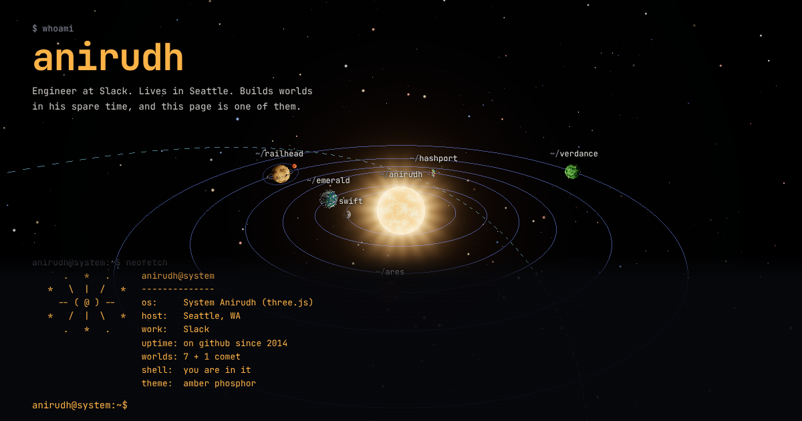

# anirudh@system

A personal page for Anirudh, rendered as a planetary system you can drive
from a terminal.

    live      https://asrijanga.github.io/anirudh/
    text      https://asrijanga.github.io/anirudh/text.html   (ANIRUDH(1), no WebGL)

## The idea

Anirudh keeps building solar systems, so his page is one. The star is him.
Every world orbiting it is a part of the story:

    star       anirudh            the centre of it all
    emerald    home, seattle      rain clouds, a needle, a mountain
    hashport   work, slack        a # shaped station passing messages
    railhead   train-game         a ring railway with a train on it
    ferris     rust-bevy-web-test a crab-orange moon of railhead
    verdance   garden-game        flowers that bloom as you get close
    ares       mars data          beacons plotting data from the surface
    swift      mercury data       small, cratered, fast
    comet      the timeline       2014 -> now, tail pointing away from the star

## Using it

Start typing anywhere and it lands on the prompt.

    help           list commands
    tour           guided voyage through every world
    ls             list the worlds
    cd <world>     fly to a world (tab completes; cd .. to come back)
    cat [world]    read a world's log
    open           open the current world's repo
    next / prev    step through the voyage (or <- ->)
    neofetch       system information
    text           the plain text version

Mouse and touch work too: drag to look, scroll to zoom, click a world.
There are a couple of undocumented commands.

## How it's built

Plain three.js and Vite, no framework. Everything is procedural, with no
textures or models to download.

    src/data/worlds.js        all content, in one file
    src/scene/                star, planets, orbits, decorations, comet, camera
    src/shaders/noise.js      simplex noise + fbm shared by the shaders
    src/ui/terminal.js        the shell: history, tab completion, clickable commands
    src/ui/commands.js        what the shell knows how to do
    src/text.js               renders the man page from the same data
    docs/STORIES.md           how it was planned, story by story

Run it locally:

    npm install
    npm run dev

Every push to main builds and deploys to GitHub Pages with
.github/workflows/deploy.yml.
