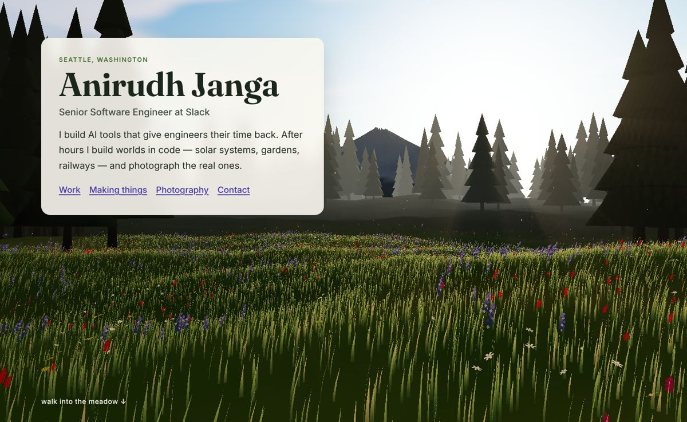
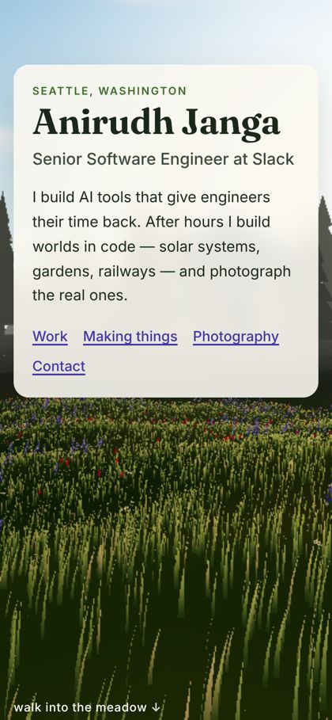
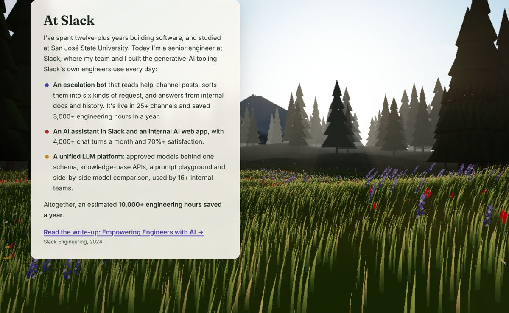
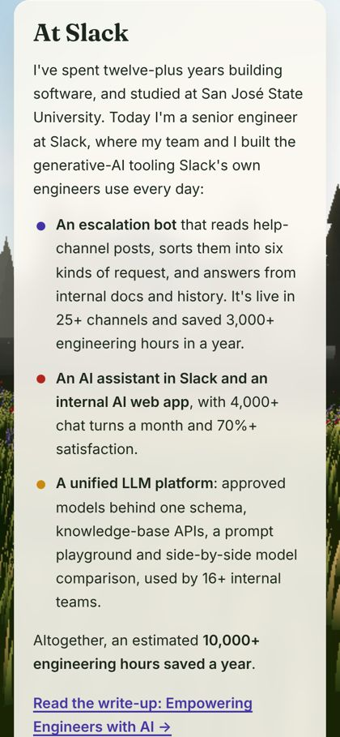
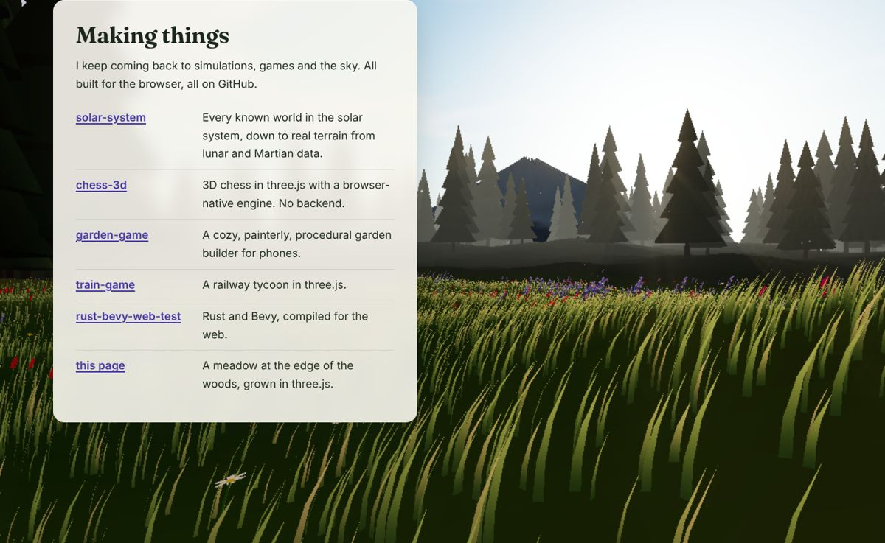
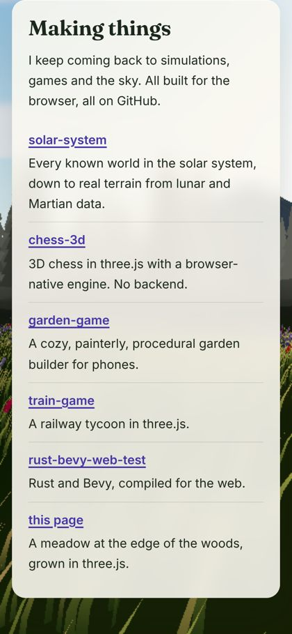
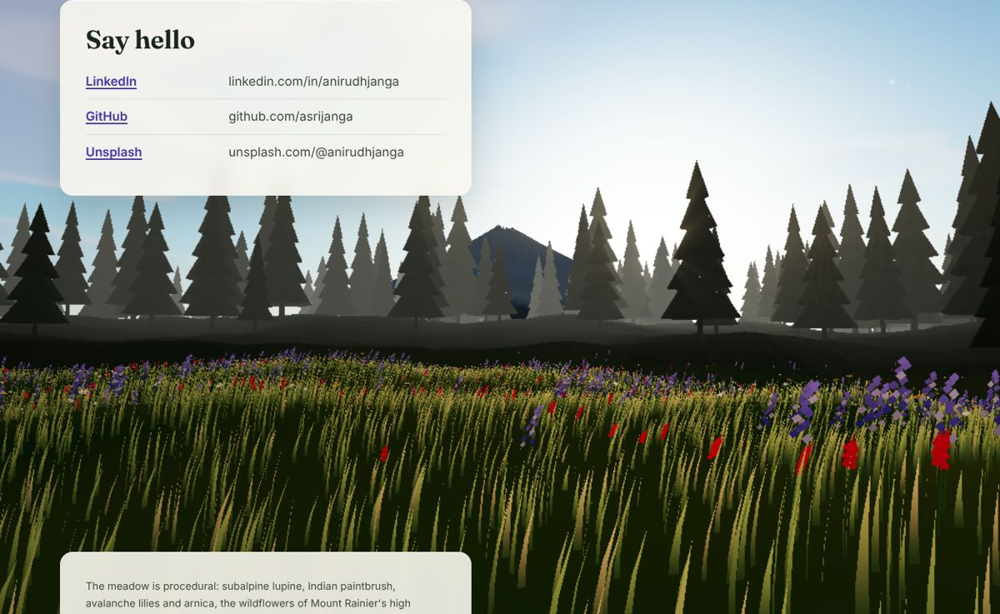
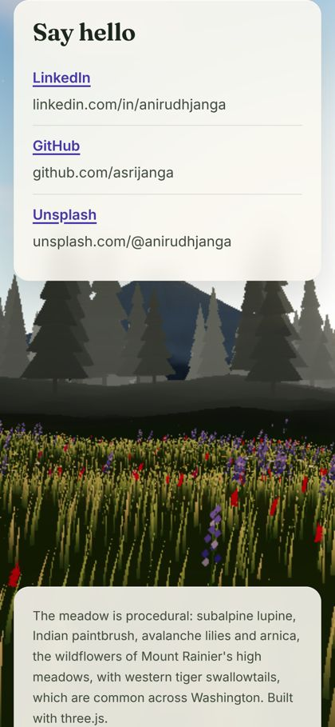

# Review — Story M6

Screenshots from the final build (headless Chromium with a software renderer,
`?quality=0.35`; on a real GPU the meadow is denser and fully animated).

| | desktop (1400×860) | phone (390×844) |
|---|---|---|
| Hero |  |  |
| At Slack |  |  |
| Making things |  |  |
| Say hello |  |  |

## Content check against RESEARCH.md

| On the page | Source in RESEARCH.md | ✓ |
|---|---|---|
| Anirudh Janga, Senior Software Engineer at Slack, Seattle | Identity table | ✓ |
| Twelve-plus years; studied at San José State University | Identity table | ✓ |
| Escalation bot: six categories, 25+ channels, 3,000+ hours in a year | Slack Engineering post | ✓ |
| Assistant + web app: 4,000+ monthly chat turns, 70%+ satisfaction | Slack Engineering post | ✓ |
| Unified LLM platform, 16+ teams; est. 10,000+ hours a year | Slack Engineering post | ✓ |
| Described as team work ("my team and I built") | Usage note | ✓ |
| solar-system, chess-3d, garden-game, train-game, rust-bevy-web-test | Side projects | ✓ |
| Photography: flowers, rivers, mountains, Milky Way; Unsplash link | Photography (confirmed) | ✓ |
| Contact: LinkedIn, GitHub, Unsplash; no email | Resolved questions | ✓ |

## Checks run

- `npm run build`: passes
- axe-core (WCAG 2 A/AA + best practice): **0 violations**
- Keyboard: the first Tab stop is the skip link, and it becomes visible
- No WebGL: no canvas; the content renders on the CSS meadow gradient
- Console: no errors across desktop, phone, the scroll walk and the fallback
